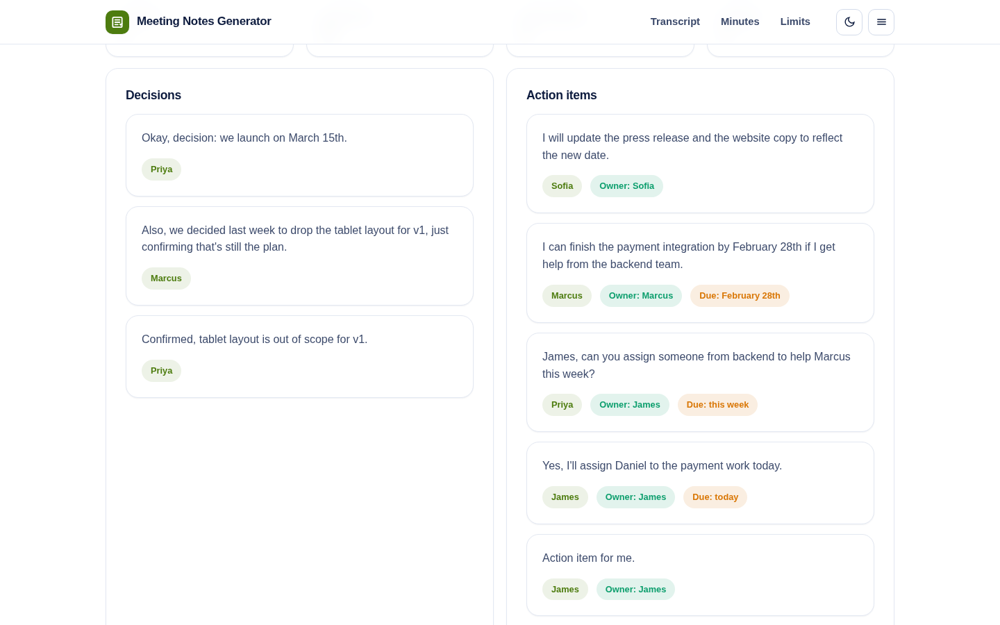
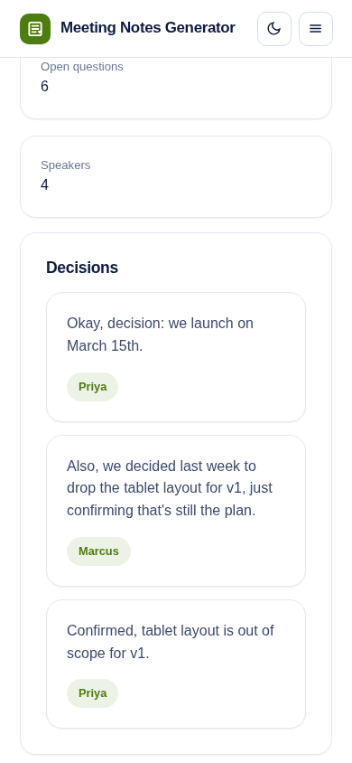

# Meeting Notes Generator

From a rambling transcript to clean minutes in one click.

Paste a meeting transcript with speaker labels and the generator pulls out decisions, action items with owners and deadlines, open questions, talk share per speaker, key topics and a short summary - then exports minutes as markdown ready for your doc or issue tracker.

**Live demo:** https://akash991833.github.io/meeting-notes-generator/



## What it extracts

- **Decisions** - "we decided", "agreed", "confirmed" - with who said them
- **Action items** - tasks with attributed owners ("James, can you...") and deadlines ("by Friday", "March 1st")
- **Open questions** - everything that ended in a question mark and never got answered
- **Talk share** - who dominated the meeting, as a percentage bar
- **Key topics** - the most-discussed subjects
- **Summary** - the three highest-value sentences of the meeting

## Features

- Paste text or upload a .txt transcript; realistic sample included
- Speaker-label parsing (one turn per line, "Name: ...")
- Export minutes as markdown with checkbox action items
- Dark and light themes, responsive, installable PWA, works offline
- Fully on-device - transcripts never leave the browser

## Honest limits

- Rule-based extraction: it catches explicitly stated decisions and tasks, not implied ones.
- Owner attribution needs speaker labels; unlabeled transcripts work but actions have no owner.
- It does not transcribe audio - paste text from your recorder or captions export.
- Review action items before sending minutes; a missed owner is worse than a missed task.

## Tech

Vanilla JS, no build step, no dependencies, no network calls. Speaker-turn parsing, pattern-based decision/action/question detection, IDF-weighted summary scoring.

## Run locally

```
python3 -m http.server 8062
# open http://localhost:8062
```

## Tests

```
python3 -m http.server 8062 &
node tests/run.mjs
```

44 checks across desktop and mobile, light and dark: speaker detection, decision and action extraction, owner and due-date attribution, questions, topics, talk share and console cleanliness.



