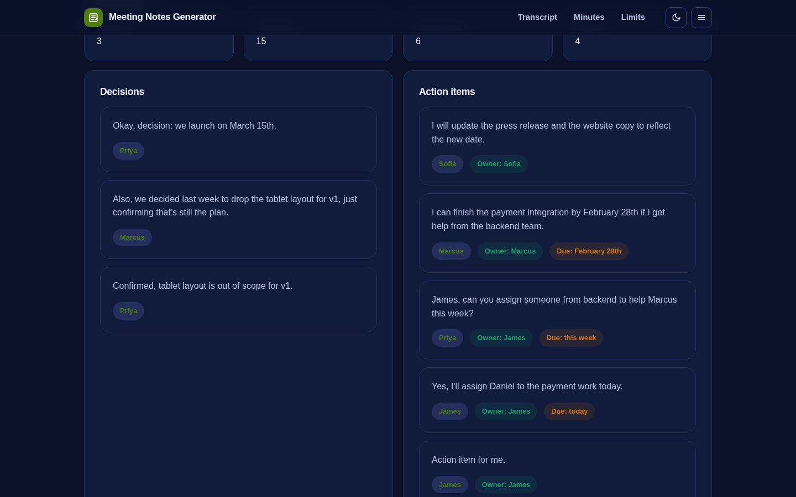

# Meeting Notes Generator - Python (scikit-learn)

> **Live browser demo:** https://akash991833.github.io/meeting-notes-generator/ - zero-install version. The app in this folder is the pro-grade rebuild; run steps below.
> **Repo:** https://github.com/AKASH991833/meeting-notes-generator



The pro-grade version of the browser demo: structured extraction from raw transcripts - attendees, action items with owners and due hints, decisions, open questions, and a TF-IDF topic map. Fully offline.

## Stack

- **Heuristic extraction layer** - speaker parsing, action/decision/question sentence classifiers, owner and due-date detection
- **scikit-learn TF-IDF** - per-slice topic labelling over meeting segments
- **Summary scorer** - decision/action-weighted extractive summary
- **Streamlit** - paste transcript, structured notes UI

## Run locally

```
pip install -r requirements.txt
streamlit run app.py
```

## Tests

```
python3 tests/test_notes_generator.py     # or: python3 -m pytest tests/ -q
```

Covers attendee parsing, owner/due extraction on action items, decision and question recall, topic/summary sanity, multi-line turns and short-input rejection.

## Honest limits

- Owner attribution is heuristic: "I'll" maps to the speaker, bare imperatives map to the addressee only when explicit.
- No diarization or audio: paste a text transcript.
- Informal chat-style text without task language yields few action items.

## Layout

- `notes_generator.py` - pure logic (no Streamlit imports), fully unit tested
- `app.py` - Streamlit UI
- `tests/test_notes_generator.py` - unit tests
